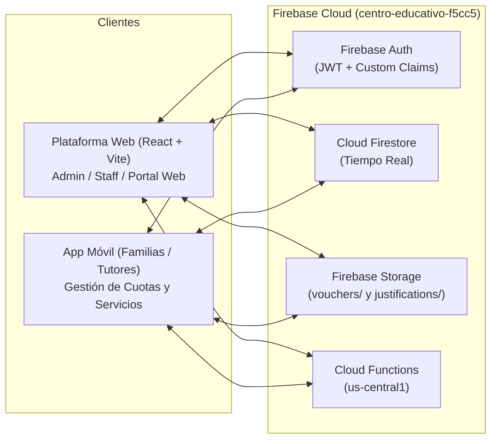

# Contexto Integral de Negocio y Arquitectura Técnica — "Educar para Transformar" (Web + Mobile)

> [!IMPORTANT]
> Este documento actúa como **Fuente Única de Verdad (Single Source of Truth)** para cualquier agente de IA que trabaje en el repositorio de **Centro educativo mobile**. Contiene el dominio del problema, las reglas de negocio obligatorias, el contrato de base de datos en **Cloud Firestore**, la estructura de **Firebase Storage**, las **Cloud Functions** desplegadas y las reglas de seguridad activas en el proyecto `centro-educativo-f5cc5`.

---

## 1. Dominio Institucional ("Educar para Transformar")

- **Institución:** Centro Educativo de gestión privada "Educar para Transformar" (Resistencia, Chaco — inicio de ciclo lectivo: Marzo 2027).
- **Modalidad:** Jornada extendida con servicio de apoyo estudiantil, comedor, transporte escolar propio, gabinete de enfermería, seguimiento de preceptoría, laboratorios e idiomas (Inglés, Portugués, Francés).
- **Niveles Educativos (`nivel`):**
  1. **Inicial:** Sala de 2 Años, Sala de 3 Años, Sala de 4 Años, Sala de 5 Años (Divisiones `A`, `B`, etc.).
  2. **Primario:** 1er Grado a 7mo Grado.
  3. **Secundario:** 1er Año a 6to Año.
- **Deportes Extracurriculares (8 disciplinas oficiales):**
  - Atletismo, Natación, Fútbol, Artes Marciales / Taekwondo, Vóleibol, Danza, Básquet, Ajedrez.
- **Transporte Escolar (4 recorridos oficiales):**
  - Flota de micros **Mercedes-Benz Sprinter** con capacidad máxima estricta de **15 plazas estándar** por recorrido:
    - `r1`: Recorrido 1 — Zona Norte (Av. Sarmiento / Av. Sabin)
    - `r2`: Recorrido 2 — Zona Sur (Av. Castelli / Av. Alberdi)
    - `r3`: Recorrido 3 — Zona Este / Centro (Plaza 25 de Mayo)
    - `r4`: Recorrido 4 — Zona Oeste / Fontana (Av. Alvear)

---

## 2. Arquitectura Compartida (Web ↔ Firebase ↔ Mobile)



### 2.1 Parámetros de Conexión al Proyecto Firebase

- **Project ID:** `centro-educativo-f5cc5`
- **Auth Domain:** `centro-educativo-f5cc5.firebaseapp.com`
- **Storage Bucket:** `centro-educativo-f5cc5.appspot.com`
- **Cloud Functions URL Base:** `https://us-central1-centro-educativo-f5cc5.cloudfunctions.net`

---

## 3. Autenticación, Roles y Cloud Functions

### 3.1 Roles del Sistema (`role`)

| Rol en Claims / Firestore  | Alcance                                                                                                   | Colección de Perfil |
| :------------------------- | :-------------------------------------------------------------------------------------------------------- | :------------------ |
| `Padre`                    | Tutor / Madre / Padre responsable de 1 o más alumnos. Accede a la App Móvil y a `/mi-portal`.             | `users/{uid}`       |
| `Estudiante`               | Alumno de la institución. Puede consultar su ficha académica.                                             | `students/{uid}`    |
| `user_admin` / `Directivo` | Administrador general. Configura tarifas, usuarios, cursos, deportes y concilia finanzas.                 | `users/{uid}`       |
| `Administrativo`           | Gestión administrativa, cobranzas y toma de asistencia de cualquier curso.                                | `users/{uid}`       |
| `Docente` / `Staff`        | Profesor. Dicta cátedras y toma asistencia únicamente en los cursos donde da clase en el día de la fecha. | `users/{uid}`       |
| `Preceptoria`              | Convivencia escolar, actas, tardanzas y toma de asistencia en cualquier curso.                            | `users/{uid}`       |
| `Enfermeria`               | Gabinete de salud. Registra atenciones médicas en el legajo del alumno.                                   | `users/{uid}`       |

### 3.2 Flujo de Login en la App Móvil

1. **Login de Padre / Tutor (`email` + `password`):**
   - Usa `signInWithEmailAndPassword(auth, email.trim(), password)`.
   - **Regla de DNI como contraseña inicial:** Al crearse un tutor en administración, su clave inicial es su DNI. Si el login falla con `auth/invalid-credential` y el password ingresado es numérico de 7 a 9 dígitos (ej. `30123456`), el cliente debe reintentar automáticamente con puntos (`30.123.456`) y viceversa antes de devolver error.
   - Al autenticarse, llamar siempre a `await firebaseUser.getIdTokenResult(true)` y luego leer `doc(db, 'users', firebaseUser.uid)`.
2. **Login de Estudiante (`legajo` + `password`):**
   - Si el identificador no contiene `@`, hacer `POST https://us-central1-centro-educativo-f5cc5.cloudfunctions.net/cf_loginStudent` con `{ studentID_login, password }`.
   - Recibe `{ customToken }` y ejecuta `signInWithCustomToken(auth, customToken)`.
3. **Cambio de Contraseña Obligatorio (`mustChangePassword: true`):**
   - Si el documento `users/{uid}` tiene `mustChangePassword: true`, solicitar cambio de clave:
     1. Ejecutar `updatePassword(auth.currentUser, newPassword)`.
     2. Llamar a `POST https://us-central1-centro-educativo-f5cc5.cloudfunctions.net/cf_completePasswordChange` enviando el header `Authorization: Bearer <idToken>`.

### 3.3 Catálogo de Cloud Functions Disponibles (`us-central1`)

| Endpoint                      | Método | Auth         | Propósito                                                                             |
| :---------------------------- | :----- | :----------- | :------------------------------------------------------------------------------------ |
| `/cf_loginStudent`            | `POST` | Pública      | Autentica un alumno por `studentID_login` y `password`, devuelve `{ customToken }`.   |
| `/cf_completePasswordChange`  | `POST` | Bearer JWT   | Limpia el flag `mustChangePassword: false` del tutor/staff en `users/{uid}`.          |
| `/cf_changeStudentPassword`   | `POST` | Bearer JWT   | Actualiza el hash de contraseña del alumno en `students/{studentId}`.                 |
| `/cf_createParentAndStudents` | `POST` | Bearer Admin | Crea tutor en Auth + `users` y sus hijos en `students` vinculados bidireccionalmente. |
| `/cf_resetUserPasswordToDni`  | `POST` | Bearer Admin | Restablece la contraseña de un tutor (`parent`) o alumno (`student`) a su DNI.        |
| `/cf_updateUserProfile`       | `POST` | Bearer Admin | Actualiza datos de perfil de usuario o alumno.                                        |

---

## 4. Contrato de Colecciones en Cloud Firestore

### 4.1 Colección `users/{uid}` (Perfil del Tutor)

```json
{
  "email": "lionel.messi@familia.edu.ar",
  "nombre": "Lionel Andrés Messi",
  "dni": "30111222",
  "telefono": "3624001122",
  "domicilio": "Av. Sarmiento 1250",
  "role": "Padre",
  "studentIds": ["student_id_1", "student_id_2"],
  "mustChangePassword": false,
  "updatedAt": "Timestamp"
}
```

### 4.2 Colección `students/{studentId}` (Legajo Integral del Alumno)

> [!WARNING]
> **Restricción de Seguridad (`firestore.rules`):** Un usuario con rol `Padre` puede actualizar `students/{studentId}` **SOLO** si modifica exclusivamente las claves listadas en `allowedFields`:
> `['servicios', 'recorridoTransporte', 'transporteFechaInicio', 'transporteBajaSolicitada', 'transporteBajaProgramada', 'comedor', 'comedorFechaInicio', 'comedorBajaSolicitada', 'comedorBajaProgramada', 'observacionesComedor', 'deportes', 'deporteFechaInicio', 'deportesSuscripciones', 'entradasEnfermeria', 'entradasPreceptoria', 'comprobantesPago', 'asistencias', 'updatedAt']`.
> Si en el `updateDoc` se envía cualquier otro campo (o se intenta pisar `nombre`, `dni`, `curso`, `nivel`, `parentId`), Firestore rechazará la operación con `Missing or insufficient permissions`.

Estructura completa de `students/{studentId}`:

```json
{
  "id": "student_id_1",
  "nombre": "Thiago",
  "apellido": "Messi",
  "nombreCompleto": "Thiago Messi",
  "dni": "52111222",
  "studentID_login": "#EST-2026-1042",
  "legajo": "#EST-2026-1042",
  "fechaNacimiento": "2014-11-02",
  "domicilio": "Av. Sarmiento 1250",
  "nivel": "primario",
  "curso": "6to Grado",
  "division": "A",
  "status": "active",
  "parentId": "<uid_del_tutor>",
  "emailPadre": "lionel.messi@familia.edu.ar",

  "servicios": ["Transporte Escolar", "Comedor Escolar"],

  "recorridoTransporte": "r1",
  "transporteFechaInicio": "2026-11-05",
  "transporteBajaSolicitada": false,
  "transporteBajaProgramada": null,

  "comedor": true,
  "comedorFechaInicio": "2026-11-05",
  "comedorBajaSolicitada": false,
  "comedorBajaProgramada": null,
  "observacionesComedor": "Sin restricciones alimentarias",

  "deportes": ["disc-1", "disc-3"],
  "deporteFechaInicio": "2026-11-05",
  "deportesSuscripciones": {
    "disc-1": {
      "fechaInicio": "2026-11-05",
      "bajaSolicitada": false,
      "bajaProgramada": null
    }
  },

  "asistencias": {
    "presentes": 18,
    "tardanzas": 1,
    "faltasInjustificadas": 1,
    "faltasJustificadas": 1,
    "totalFaltas": 2,
    "totalClases": 21,
    "porcentaje": 88,
    "porcentajeAsistencia": 88,
    "historial": [
      {
        "id": "att-2026-11-05-student_id_1",
        "fecha": "2026-11-05",
        "tipo": "Falta Injustificada",
        "estado": "justificacion_pendiente",
        "motivo": "Ausencia sin aviso previo",
        "justificada": false,
        "vistoPorTutor": true,
        "fechaVisto": "2026-11-05T20:10:00.000Z",
        "justificacion": {
          "studentId": "student_id_1",
          "absenceId": "att-2026-11-05-student_id_1",
          "motivo": "Consulta / Reposo Médico",
          "detalle": "Certificado pediátrico adjunto",
          "certificado": "CERT-9921",
          "comprobanteNombre": "certificado.pdf",
          "comprobanteTamanio": "310.5 KB",
          "comprobanteUrl": "https://firebasestorage.googleapis.com/...",
          "comprobanteStoragePath": "justifications/<uid>/...",
          "fechaPresentacion": "2026-11-05T21:00:00.000Z",
          "estado": "En revisión por Preceptoría"
        }
      }
    ]
  },

  "entradasEnfermeria": [
    {
      "id": "enf-1730840000",
      "fecha": "05/11/2026, 10:15 hs",
      "sintoma": "Cefalea leve",
      "atencion": "Control de signos vitales y reposo 20 min en gabinete.",
      "profesional": "Enfermería Escolar",
      "vistoPorTutor": false,
      "fechaVisto": null
    }
  ],

  "entradasPreceptoria": [
    {
      "id": "prec-1730845000",
      "fecha": "04/11/2026, 08:05 hs",
      "tipo": "Tardanza",
      "motivo": "Ingreso 15 minutos después del timbre.",
      "autor": "Preceptoría",
      "vistoPorTutor": true,
      "fechaVisto": "2026-11-05T14:00:00.000Z"
    }
  ],

  "comprobantesPago": [
    {
      "id": "rec-fam-30111222-noviembre-2026",
      "invoicePeriod": "Noviembre 2026",
      "uploadDate": "06/11/2026",
      "declaredAmount": 125000,
      "operationCode": "TRF-88271",
      "originBank": "Banco Nación",
      "fileName": "comprobante-noviembre.pdf",
      "fileSize": "412.0 KB",
      "fileUrl": "https://firebasestorage.googleapis.com/...",
      "storagePath": "vouchers/<uid>/...",
      "status": "pendiente"
    }
  ]
}
```

### 4.3 Colección `tariffs_config/current` (Cuadro Tarifario Oficial)

- Solo los Administradores modifican `tariffs_config/current`.
- La App Móvil lee este documento para calcular el valor de:
  - Cuota mensual según nivel (`inicial`, `primario`, `secundario`).
  - Cada uno de los 4 recorridos de transporte (`tariffs.transport[]`).
  - Plan de comedor escolar (`tariffs.dining[]`).
  - Cada disciplina deportiva (`sportsPrices[disciplineId]`).

### 4.4 Colección `finance_receipts/{receiptId}` (Facturación y Conciliación)

- Representa la factura mensual y sus comprobantes asociados.
- **Estados (`status`):**
  - `'sin_comprobante'`: Factura emitida pendiente de pago (aún no se cargó transferencia).
  - `'pendiente'`: El tutor subió uno o más comprobantes de transferencia bancaria y está pendiente de conciliación por Administración.
  - `'conciliado'`: Pago verificado y aprobado por Administración (o pago completo).
  - `'rechazado'`: Comprobante observado/rechazado por Administración (con motivo en `rejectionReason`).
- **Soporte para múltiples comprobantes y selección de ítems (Regla Parte 3):**
  - El tutor puede seleccionar qué ítems de la factura está abonando en cada transferencia (`selectedItems`: array de IDs de ítems de `feeBreakdown`).
  - Si realiza un pago parcial (ej. abona solo Cuota + Comedor hoy, y la semana siguiente abona Transporte + Deportes), puede adjuntar un nuevo comprobante sobre la misma factura. Guardar el último en `bankingVoucher` (para compatibilidad directa con la tabla de Finanzas Web) y acumular todos los envíos en el array `vouchersHistory` dentro del mismo documento de `finance_receipts`.

---

## 5. Reglas de Negocio Críticas que el Agente Mobile Debe Respetar

1. **Prohibición de Datos Hardcodeados en Perfiles Reales:**
   - Jamás inyectar faltas, entradas de enfermería, entradas de preceptoría ni hijos ficticios si el alumno o tutor no los tiene en Firestore.
2. **Política Universal de Suscripción, Prorrateo y Bajas (Transporte, Deportes y Comedor):**
   - **Alta y Proporcional:** Cuando un padre inscribe a su hijo en un servicio, se guarda `fechaInicio = YYYY-MM-DD` (día actual). El importe del primer mes se calcula de forma proporcional a los días restantes del mes (`diasActivos / diasDelMes`).
   - **Ventana de Cancelación Inmediata (Mismo Día):** El tutor **solo puede dar de baja inmediata** un servicio si la baja se ejecuta **antes de que finalice el mismo día de inscripción** (`fechaInicio === hoy`).
   - **Baja Diferida al Mes Siguiente:** A partir del día siguiente al alta (`fechaInicio < hoy`), el servicio no puede darse de baja en lo que resta del mes en curso (únicamente un Administrador puede forzarlo desde la Web). El tutor puede presionar **"Solicitar baja para el próximo mes"**, lo cual marca `bajaSolicitada: true` y `bajaProgramada: YYYY-MM-01` (primer día del mes siguiente).
3. **Reglas de Deportes Extracurriculares:**
   - Máximo **2 deportes activos simultáneamente** por alumno.
   - **Validación de superposición horaria:** Antes de inscribir a un segundo deporte, verificar que sus días y horarios no colisionen con el deporte ya inscripto.
   - Al inscribir/desinscribir, actualizar tanto `students/{studentId}` como el documento `sportsActivities/{disciplineId}` (`inscriptos` y `anotados`).
4. **Reglas de Transporte Escolar:**
   - Existen **4 recorridos** con valores diferenciados.
   - Cada recorrido cuenta con una Sprinter de **15 plazas máximas**. Verificar ocupación antes de confirmar el alta.
5. **Reglas de Pagos y Comprobantes:**
   - **Exclusivamente por transferencia bancaria** (no existe pago en efectivo).
   - El tutor selecciona los ítems a pagar, ingresa monto declarado, código de operación, banco de origen y adjunta el comprobante ($\le 2\text{ MB}$, formatos `.pdf`, `.png`, `.jpg`, `.jpeg`).
   - El archivo se sube a Firebase Storage en `vouchers/{auth.currentUser.uid}/{timestamp}_{fileName}` y se vincula a la factura en `finance_receipts` y al alumno en `students/{studentId}.comprobantesPago`.
   - El sistema emite un comprobante digital de pago / recepción para el padre.
6. **Automatizaciones de Correo / Avisos de Deuda:**
   - **Último día hábil del mes:** Recordatorio por email con el total a abonar discriminado por ítem + factura adjunta.
   - **Día 20 de cada mes:** Notificación por email con el detalle de deuda en caso de no registrarse el pago completo del período.
